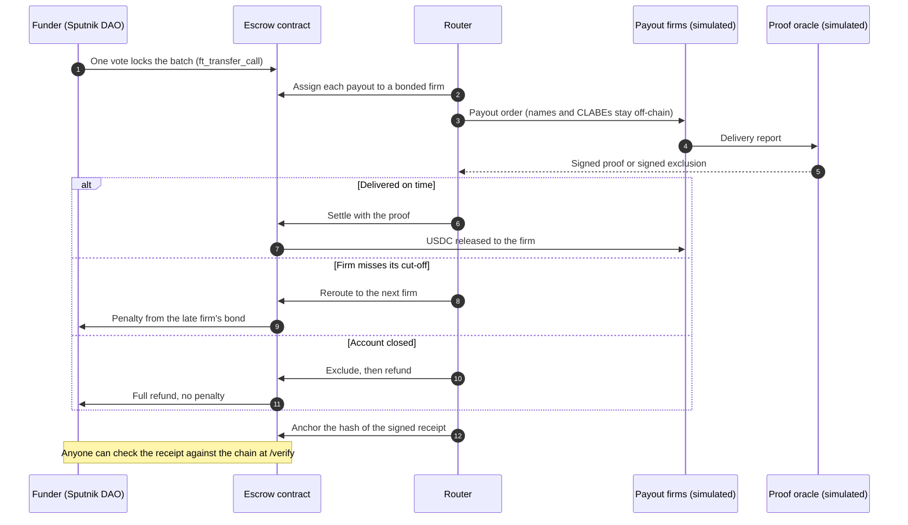

<p></p>

# Relevo Payout Guard

[](https://github.com/elixirlabs-dev/Relevo/actions/workflows/ci.yml)

> **Testnet prototype. Payout firms and SPEI receipts are simulated. Contract unaudited.**
> Not a money transmitter and not a live service.

**Live demo (NEAR testnet):** https://relevo-amber.vercel.app

**At a glance**

| What | Try it |
|---|---|
| A DAO votes once; USDC locks in a NEAR escrow; bonded payout firms deliver; a late firm is rerouted and its bond pays a penalty; a closed account is refunded in full | [Batch 5 on-chain](https://relevo-amber.vercel.app/chain/5) |
| Every payout ends in a signed receipt whose hash is anchored on-chain; your browser verifies it and exports a delivery report and CSV | [/verify](https://relevo-amber.vercel.app/verify) |
| Receipts for payouts made **outside** the escrow, on any rail: issue one with your own testnet wallet (Meteor, Intear or Sender) | [/issue](https://relevo-amber.vercel.app/issue) |
| **Post-quantum** receipt signatures: ML-DSA-65 (FIPS 204) beside ed25519, both checked against keys on-chain | [/issue](https://relevo-amber.vercel.app/issue) or the sample on [/verify](https://relevo-amber.vercel.app/verify) |
| Share a verified receipt as a link: the receipt travels in the link's fragment and is checked when it opens | after any check on /verify or /issue |
| Check a batch **before** paying: CLABE typos, duplicate accounts, unusual amounts and changed accounts are caught in your browser; anchor the signed check report on NEAR, and a later receipt shows it was checked first | [/check](https://relevo-amber.vercel.app/check) |
| Each payee gets a private link to their own payout only, checked against NEAR in their browser (EN/ES). It checks the payer's record, not the bank's: name-to-account matching and bank (CEP) proof are not built. Treat a payee link like a payslip: whoever holds it can test guesses of that payee's account number, so send it only to that payee | links from [/issue](https://relevo-amber.vercel.app/issue) |
| Attestations: an auditor or DAO member who verified a receipt vouches for it with their NEAR account; DAO members are labelled with their role | the payroll receipt v2 on [/verify](https://relevo-amber.vercel.app/verify) |
| Two Rust contracts (escrow, receipt registry), property-tested invariants, end-to-end tests on a local NEAR sandbox | [Run the tests](#run-the-tests) |

A DAO votes once to pay a batch of contributors in Mexico. The USDC locks in a NEAR escrow, and bonded payout firms deliver. A late firm is rerouted automatically and its bond pays a penalty to the DAO. Every payout ends in a signed receipt, whose hash is anchored on-chain.

**Who it's for.** The demo's funder is a DAO, and that is the only case built and tested. The same pattern fits anyone who has to prove a payout arrived:

- **Grant and aid programmes:** show donors which payouts were delivered, with a report they can check against the chain.
- **Payroll and contractor platforms:** settle "I wasn't paid" with a per-payout proof, and give auditors a CSV that verifies.
- **Payout providers:** post a bond, deliver on time, and build an on-chain delivery record.

The receipt comes first, and it works without the escrow too: an issuer that pays on any rail can sign a receipt for those payouts and anchor it in the receipt registry. The escrow and bonds are the stronger level on top (see the product ladder in [docs/production-readiness.md](docs/production-readiness.md)).

## Try it

No keys, accounts or funds are needed.

1. **See a finished batch on chain.** Open https://relevo-amber.vercel.app/chain/5: the reference run (batch 5), read straight from the escrow on NEAR testnet. Every step, from the DAO vote to the anchored receipt, is linked in [Reference run, step by step](#reference-run-step-by-step).
2. **Verify its receipt in your browser.** Open https://relevo-amber.vercel.app/verify and choose "Use the testnet reference receipt (batch 5)". Four checks run in your browser, and all four pass.

   To run the same site locally instead:

   ```bash
   git clone https://github.com/elixirlabs-dev/Relevo.git && cd Relevo
   pnpm install
   pnpm web:testnet   # read-only; reads NEAR testnet, signs nothing
   ```
3. **Tamper with it.** Download the [reference receipt](apps/web/public/receipts/testnet-batch-5.json), change any amount, and upload it on the same page. The signature check fails.
4. **Check a post-quantum receipt for payouts made outside the escrow.** On the same page, choose "Use a payroll receipt made outside the escrow (post-quantum signed)". A sample payroll issuer paid five contractors on its own, then signed the receipt twice, with ed25519 and with ML-DSA-65 (FIPS 204, post-quantum), and anchored it in the receipt registry. The same four checks run against the registry, and both signatures must match the keys the issuer published on-chain.

5. **Issue your own receipt, with your own wallet.** Open https://relevo-amber.vercel.app/issue, connect a NEAR testnet wallet (Meteor, Intear or Sender; Meteor and Intear can create a testnet account in a minute), and sign the sample payouts or your own. Your browser signs the receipt (ed25519 plus an optional ML-DSA-65 post-quantum signature); names and account numbers never leave it. One wallet transaction publishes your receipt keys and anchors the receipt in the registry, then the page verifies it against the chain. It costs about 0.025 testnet NEAR of storage.

6. **Check before paying, send payee links, attest.** On https://relevo-amber.vercel.app/check, load the sample with problems to see what gets blocked, or the clean sample to anchor a check report. The next receipt you issue on /issue names that check, and /verify shows it was anchored first. That "Checked before payment" line appears only on receipts issued from /issue after anchoring a check on /check: the v2 sample on /verify has no linked check. /issue gives each payout a private link to /payee, where the payee sees only their own payout. On /verify, choose "Use the payroll receipt v2 (per-payee proofs)": the Attestations panel lists who has vouched for it (the sample DAO's council already has), and "Attest that you checked this receipt" adds your account for 0.01 testnet NEAR of storage. You vouch that you ran the checks, not that the payments happened.

Each firm's bond and on-chain record is at https://relevo-amber.vercel.app/firms.

## What is real and what is simulated

| Part | Status |
|---|---|
| Escrow, bond vault and receipt registry (`contracts/escrow`, Rust, near-sdk 5.30) | Real contract, on testnet. Unaudited. |
| Sputnik DAO v2 vote that funds the batch | Real DAO from the official testnet factory (`sputnikv2.testnet`) |
| Router: quotes, assignment, reroute, settle, refund, receipt anchoring (`apps/router`) | Real service. It signs only with a function-call key limited to six escrow methods. |
| Signed receipts and `verify-receipt` | Real ed25519 signatures over RFC 8785 canonical JSON. The hash is anchored on-chain. |
| Receipt registry for payouts made outside the escrow (`contracts/registry`, Rust), the `/issue` page and `pnpm issue-receipt` | Real contract, on testnet. Unaudited. An issuer publishes its receipt keys and anchors each receipt's hash; anchors can't be replaced. Any account can attest a receipt it checked (once per account, up to 100). |
| Post-quantum receipt signatures (ML-DSA-65, FIPS 204) | Real, for receipts made outside the escrow: a second signature beside ed25519, checked in the browser against the issuer's ML-DSA-65 key in the registry. Uses `@noble/post-quantum`, which has not been independently audited. Batch receipts from the escrow are still ed25519 only. |
| Receipt format, `/verify` and CSV export | Real. The format is published as a JSON Schema with test vectors ([`docs/receipts`](docs/receipts/)). `/verify` checks a receipt against the chain in the browser and exports it as CSV once every check passes. |
| CSV import with CLABE check-digit validation | Real |
| Web app (`apps/web`, Next.js) | Real. Payout state comes from the escrow's view methods; the router only adds payee names (last 4 digits of the account) and tx links. |
| Pay-in quote from ETH, BTC, SOL or Base USDC | **Real mainnet quote** from the NEAR Intents 1Click API (dry quote), shown for illustration. Nothing is sent. |
| Payout firms MX-1, MX-2, MX-3 (`apps/firm-sim`) | **Simulated.** No MXN moves. MX-3 is configured to be late. |
| Proof oracle and SPEI/CEP references (`apps/oracle`) | **Simulated.** Signs a proof in the shape of a CEP reference. |
| USDC | **Mock** NEP-141 token (`contracts/mock-usdc`, "mUSDC", 6 decimals) |
| MXN/USDC rate | **Fixed** at 18.50 (`MXN_PER_USDC`) |
| Penalty clock | **Demo mode:** one penalty "hour" is 10 seconds. The contract also has a real-time mode (1 hour). |

## Quick start

Requirements: Node 22+ and pnpm 10, on macOS or a Linux with glibc 2.38 or newer (Ubuntu 24.04+, Debian 13+), which the local NEAR sandbox binary needs. `make test` also needs Rust; `rust-toolchain.toml` pins 1.95.0, and you need [cargo-near](https://github.com/near/cargo-near) 0.23.

```bash
make setup   # pnpm install; fetch the Sputnik DAO wasm (hash-checked); generate local keys in .data/
make demo    # full batch on a local NEAR sandbox, about 1 minute; no accounts or keys needed
make test    # contracts (unit, property, sandbox) + TypeScript (lint, typecheck, unit)
pnpm dev     # the web app on a local sandbox: http://localhost:3000/new
```

To look at the testnet reference run without any keys: `pnpm web:testnet`, then open http://localhost:3000/chain/5 and http://localhost:3000/firms.

## Run the demo

`make demo` starts a local NEAR sandbox and deploys mock USDC, the escrow, a Sputnik DAO and three bonded firms. It then runs the oracle, the three firm simulators and the router as separate processes, and drives one batch from start to finish:

1. A CSV with a typo is blocked before the run (`row 5: clabe_check_digit`).
2. `samples/payees.csv` (5 invented payees) validates. Only a salted hash and amounts go on-chain.
3. The router builds a Sputnik `add_proposal`; the council votes once, and the USDC locks in the escrow.
4. Each payout goes to the cheapest eligible bonded firm (bond × 20 limits each firm's open exposure).
5. MX-3 misses its cut-off. Within seconds the router reroutes the payout to the next firm, and MX-3's bond pays 1 bp per period late to the DAO (capped at 2%).
6. One payee's account is closed. The firm reports it, the oracle signs an `ACCOUNT_CLOSED` exclusion, and the payout is refunded in full with no penalty to anyone.
7. Every payout ends Delivered or Refunded. The router signs the batch receipt and anchors its hash.
8. `verify-receipt --chain` prints `OK`, and the same receipt with one number edited prints `FAIL: bad_signature`.

The demo exits non-zero if any of its outcome checks fails. The receipt is written to `.data/receipts/`, and service logs go to `.data/logs/`.

Verify a receipt yourself:

```bash
pnpm verify-receipt .data/receipts/<file>.json --chain --rpc <rpc-url> --escrow <escrow-account>
pnpm verify-receipt .data/receipts/<file>.json --pubkey ed25519:<receipt-key>
```

Or in the browser: `pnpm web:testnet`, then open http://localhost:3000/verify and verify the reference receipt (batch 5) against testnet.

The public key always comes from the chain (`--chain`) or from you (`--pubkey`), never from the file itself.

**On testnet:** `make demo-testnet` runs the same flow against the deployment below. It needs the deployer's keys in `~/.near-credentials`, so it can only be run by whoever created the deployment. To create your own deployment, run `make deploy-testnet` and then `./scripts/testnet-dao.sh`; both use faucet-funded accounts.

## Web app

`pnpm dev` starts a local sandbox, the router, the oracle and the three firm simulators, then the web app at http://localhost:3000. The screens are:

1. **New batch** (`/new`): upload or paste a CSV, or use a sample. Every CLABE is checked; one bad row blocks the batch.
2. **Quote**: payees with the last 4 digits only, payouts, the 25 bps fee buffer, the total to lock, the fixed rate and the deadlines. Below that is a live 1Click pay-in quote (ETH, BTC, SOL or Base USDC). It is a mainnet price for illustration; 1Click's own app fee is shown.
3. **Propose & vote** (`/batches/<id>`): create the Sputnik DAO proposal, then approve it as the council.
   - On the sandbox, a **demo signer** labelled "Demo signer: local sandbox keys, not a wallet" signs with the local council key. It only signs this app's funding proposal.
   - On testnet (`pnpm dev:testnet`), the DAO steps are signed with a wallet: Meteor Wallet, Intear Wallet or the Sender extension. Anyone can create the proposal, and only a council member can approve it. Like `make demo-testnet`, this runs the router with the deployer's keys, so only whoever created the deployment can run it. It changes nothing on-chain at start-up. Without those keys, use `pnpm web:testnet` (read-only).
4. **Live status**: each payout's state, route (e.g. MX-3 → MX-2), the penalty paid to the DAO, the proof reference and tx links. When the batch completes it shows the anchored receipt hash, a receipt download and the `verify-receipt` command.

5. **Verify** (`/verify`): upload or paste a receipt, or on testnet load the reference receipt for batch 5. Your browser runs four checks and shows the result of each:
   - the receipt belongs to this app's escrow and network;
   - it is signed by the batch's receipt key, read from the chain;
   - its hash matches the hash anchored on-chain;
   - its totals add up from its rows.

   Once every check passes, the page shows a printable delivery report (for a donor or auditor), and the payouts download as a CSV for accounting tools. The format, schema and test vectors are in [`docs/receipts`](docs/receipts/).

`/chain/<batch id>` shows any funded batch straight from the contract, with no router, and `/firms` shows each firm's bond, on-time record, penalties and volume. Payout state always comes from the chain, so a reload shows the same state. If the router goes down, a batch page keeps showing the on-chain state it already knows, and says the router is offline.

While the web app runs, logs go to the temp folder `pnpm dev` prints, not to `.data/logs`, because writes inside the repo would make the dev server reload the page.

## Public read-only site

Deployed at https://relevo-amber.vercel.app. With no settings at all, the web app runs as a read-only site for the testnet deployment: `/chain/5` (the reference run), `/firms`, `/issue` and `/verify`. There is no router and no server-side key; on `/issue` the visitor's own wallet signs. "New batch" is hidden, and `/rpc` only forwards view calls on the escrow and the receipt registry, plus `get_policy` on the DAO (to label attesters with their DAO role).

- **Vercel:** import the GitHub repo, set **Root Directory** to `apps/web`, and deploy. No environment variables are needed.
- **Any Node host** (Railway, Render, a VM): run `pnpm install`, then `pnpm --filter @elivo/web build`, then `pnpm --filter @elivo/web start:public`. It listens on `$PORT`.

To point it at another deployment, set `ELIVO_DEPLOYMENT_JSON` (the deployment file's contents) and optionally `NEAR_RPC_URL`.

## Run the tests

```bash
make test              # everything below except the sandbox end-to-end tests
make test-contracts    # cargo: unit + proptest invariants + near-workspaces sandbox scenarios + Sputnik DAO flow
make test-ts           # biome lint, tsc, vitest unit tests
pnpm test:e2e          # TypeScript end-to-end on a local sandbox (local stack + full batch flow)
```

What the tests pin down:

- **Contract invariants** (property tests over random operation sequences):
  - The escrow balance equals open payouts plus bonds.
  - Every payout pays out at most once.
  - Penalties never exceed 2% of a payout or the firm's bond.
  - Penalties go 100% to the funder.
  - No path sends escrowed funds anywhere except the current firm (on a valid proof) or the funder.
- **Receipt registry** (unit tests, plus an end-to-end test on the sandbox): an anchor can't be replaced; an issuer without keys can't anchor; rotating keys leaves older receipts verifiable; two issuers can use the same receipt id; the caller pays for the storage it adds.
- **Sandbox scenarios:**
  - happy path
  - late payout with reroute
  - refund after the deadline
  - closed-account exclusion
  - bond exhaustion
  - paused contract
  - double settlement after a reroute
  - wrong token
  - events with no personal data
  - Sputnik approve, reject, and refund back to the DAO
- **Rejection paths:**
  - wrong oracle signature
  - proof for another payout
  - reused nonce
  - router-only methods
  - config pinned in the funding message, so a config change between vote and execution refunds the batch
- **End to end (TypeScript, sandbox):**
  - exactly one refund (the closed account);
  - an on-time delivery;
  - a reroute away from MX-3 with a penalty, within 10 s of the cut-off;
  - `verify-receipt --chain` OK;
  - the DAO's final balance;
  - no payee name or CLABE in any chain call;
  - after a router restart, the web app's status model equals the contract's views (F13);
  - the firm scoreboard recomputed from the contract's events equals its on-chain counters (F16).
- **Web app (vitest + happy-dom):**
  - status labels and totals;
  - no full CLABE rendered;
  - router offline and contract paused;
  - the validation errors block the batch;
  - only council members can approve;
  - 1Click failures (timeout, HTTP error, bad response, unknown asset) show a message instead of breaking the page.

## Architecture

The life of one batch:



The components and who can call what:

```
 web app (Next.js): CSV upload, quote, propose & vote, status ── reads contract views via RPC
   │
 CSV ──► router ── builds proposal args ──► council signs add_proposal + act_proposal ──► Sputnik DAO
 (names, CLABEs                                                                              │
  stay local)                                                    ft_transfer_call on approval │
                                                                                              ▼
 router (function-call key) ── assign / reroute / settle / exclude / refund / anchor ──► elivo-escrow
   │  ▲                                                                                 (holds funds:
   │  └── signed proofs / exclusions ── proof oracle (simulated CEP)                    payouts, bonds,
   └── orders ──► payout firms MX-1..MX-3 (simulated) ── deliveries ──► oracle          receipt hashes)
```

- **Only the escrow contract holds funds.** The router can assign, reroute, settle, exclude, refund and anchor receipts; it cannot withdraw.
- **Each batch snapshots the router, the oracle key and the receipt key when it is funded.** The funding message must name the live router and oracle key, so rotating them can't capture a batch that has already been voted.
- **A firm needs owner approval and a bond.** Its open exposure is capped at 20× the bond.
- **Penalty rule:** `min(amount × periods × 1 bp, 2% of amount − penalties so far, bond)`, paid to the DAO.
- **Refunds:** anyone can trigger one after the final deadline, or at once after a signed exclusion. Refunds and settlement still work while the contract is paused.

Repo layout:
- `contracts/`: Rust contracts (escrow, receipt registry, mock USDC) and their tests, with committed wasm in `contracts/res/`
- `packages/shared/`: CLABE, CSV, money, borsh messages, keys, receipts, chain client, local sandbox stack
- `apps/`: web app, router, oracle and firm simulators
- `scripts/`: demo, deployment and keys
- `docs/superpowers/`: design spec and implementation plans

**Trust model (what this prototype does not solve):**
- The router and the oracle are trusted. Whoever signs delivery proofs releases money.
- In production, a custodian holding a second release key closes that gap.
- The deployer keeps a full-access key to the router account offline; the router service itself only ever uses the function-call key.
- The contract is unaudited.

## Testnet deployment

Demo mode: one penalty period is 10 s.

| Role | Account |
|---|---|
| Escrow | [escrow.pg-1794403941.testnet](https://testnet.nearblocks.io/address/escrow.pg-1794403941.testnet) |
| Mock USDC | [usdc.pg-1794403941.testnet](https://testnet.nearblocks.io/address/usdc.pg-1794403941.testnet) |
| Router (function-call key) | [router.pg-1794403941.testnet](https://testnet.nearblocks.io/address/router.pg-1794403941.testnet) |
| Firms | [mx1](https://testnet.nearblocks.io/address/mx1.pg-1794403941.testnet) · [mx2](https://testnet.nearblocks.io/address/mx2.pg-1794403941.testnet) · [mx3](https://testnet.nearblocks.io/address/mx3.pg-1794403941.testnet) `.pg-1794403941.testnet` |
| DAO (Sputnik v2) | [elivo-1794414333.sputnikv2.testnet](https://testnet.nearblocks.io/address/elivo-1794414333.sputnikv2.testnet) |
| Receipt registry | [registry.pg-1794403941.testnet](https://testnet.nearblocks.io/address/registry.pg-1794403941.testnet) |
| Sample issuer (payouts outside the escrow) | [payroll.pg-1794403941.testnet](https://testnet.nearblocks.io/address/payroll.pg-1794403941.testnet), receipt `2026-11-contractors` (ed25519, key version 1) anchored in [5jpN13rk…](https://testnet.nearblocks.io/txns/5jpN13rkWvJsPreDv5aFiv9WCJnp6v98tJgow8LaDxBh); receipt `2026-11-contractors-pq` (ed25519 + ML-DSA-65, key version 2) anchored in [Fg5PANuD…](https://testnet.nearblocks.io/txns/Fg5PANuDvpADDG5GsJHydD3Tm68YV7rHd5DU4GEcjaRj) |
| Reference run | Batch 5, receipt anchored in [2qeoXKVn…](https://testnet.nearblocks.io/txns/2qeoXKVnS28WxkdEy5kaAb7CRbk5jRviq2Lq2BavWg3M) |

### Reference run, step by step

Batch 5 locked 9,022.50 mUSDC for five payouts. These are its transactions on testnet (payouts 1 and 4 followed the same path as payout 0):

| Step | What happened | Transaction |
|---|---|---|
| Fund | The council's vote executes the DAO proposal, and 9,022.50 mUSDC moves from the DAO to the escrow. | [ATTMEjgW…](https://testnet.nearblocks.io/txns/ATTMEjgW7cF5iXxHiyFSXSpxSpTZ2bY1aLTFgjGBfVd7) |
| Assign | Payout 0 (2,000 mUSDC) is assigned to MX-3. | [7ZMrTDML…](https://testnet.nearblocks.io/txns/7ZMrTDMLxQwuGHa8MtxMEh4SCenXKAdNs3XgpFVq83Sz) |
| Reroute and penalty | MX-3 misses its cut-off. Payout 0 moves to MX-2, and 0.40 mUSDC from MX-3's bond goes to the DAO. | [E6yYwDQ2…](https://testnet.nearblocks.io/txns/E6yYwDQ2J3C7qtFaMLKUgiqzcV1KQDbTjRP6fRj9e5yw) |
| Settle | MX-2 delivers payout 0, and the escrow releases the funds against the signed proof. | [3xVfGvAg…](https://testnet.nearblocks.io/txns/3xVfGvAgoaSyVsP7AikGSVf6RcPUXZkwfguoej3Nb3H8) |
| On-time delivery | Payout 3 (2,500 mUSDC) is settled with MX-2 before its cut-off, with no penalty. | [B1KEzopQ…](https://testnet.nearblocks.io/txns/B1KEzopQMw4kGwSbuEF9VS9jdttRujvDFG5wnJs7BMgs) |
| Exclude | Payout 2's account is closed, and the oracle's signed exclusion is recorded. | [GyKXiBNr…](https://testnet.nearblocks.io/txns/GyKXiBNrBL7T9w8WiiskeYQuihGBynmt1uJhuUix4W1X) |
| Refund | Payout 2 (1,500 mUSDC) returns to the DAO in full, with no penalty to anyone. | [ARVbCvHZ…](https://testnet.nearblocks.io/txns/ARVbCvHZGmukRtciDJyMTy18985pArnpJP2fCKf3Zke2) |
| Anchor | The hash of the signed receipt is stored in the escrow. | [2qeoXKVn…](https://testnet.nearblocks.io/txns/2qeoXKVnS28WxkdEy5kaAb7CRbk5jRviq2Lq2BavWg3M) |

### What it costs on testnet

Measured from the transactions above (gas burnt across all receipts of each transaction; fees at the testnet gas price):

| Operation | Gas | Fee | Storage paid |
|---|---|---|---|
| Fund a batch (the DAO's `act_proposal` executes, USDC moves to the escrow) | 15.0 Tgas | 0.0014 NEAR | none extra |
| Assign a payout to a firm | 3.0 Tgas | 0.0003 NEAR | none |
| Reroute a late payout, with the penalty to the DAO | 7.9 Tgas | 0.0007 NEAR | none |
| Settle a payout (check the signed proof, release the funds) | 12.1 Tgas | 0.0011 NEAR | none |
| Exclude a closed account (signed exclusion) | 3.2 Tgas | 0.0003 NEAR | none |
| Refund a payout to the DAO | 7.0 Tgas | 0.0006 NEAR | none |
| Anchor a batch receipt in the escrow | 2.9 Tgas | 0.0003 NEAR | none |
| Registry: publish keys (with ML-DSA-65) and anchor a receipt, in one transaction | 6.0 Tgas | 0.0005 NEAR | 0.0229 NEAR |
| Registry: anchor a receipt when the keys are already published | 3.0 Tgas | 0.0003 NEAR | 0.0014 NEAR |

A payout delivered on time costs about 15 Tgas (0.0014 NEAR) in router calls. The registry refunds whatever storage deposit it doesn't use; the post-quantum key (1,952 bytes) is stored once per key version, not per receipt.

Batches 0–3 were development runs; their open payouts were refunded to the DAO. Batch 2's anchored hash came from a receipt that changed after signing (a bug since fixed), so it does not verify. Batch 4 is a complete run from before the final review fixes, and batch 5 is the reference.

## Tracks entered and why

- **Real-World Money (primary).** Batch payouts to Mexican bank accounts, with account checks before the run, a delivery deadline, penalties and auditor-ready receipts.
- **Social Money (secondary).** A DAO votes once on a contributor payout batch through an ordinary Sputnik DAO v2 proposal; the guarantee and the receipts attach to that vote.

What is new: intent networks already guarantee crypto delivery. This applies the same bonded, penalised pattern to the fiat last mile.

## Roadmap

What stands between this prototype and production, what to improve next, and where the project could go: [docs/production-readiness.md](docs/production-readiness.md). In short:

- Real payout-firm adapters in place of the simulators, and a bank-side proof source in place of the simulated oracle.
- A custodian-held second release key.
- Sealed commit-reveal quotes; the full set of exclusion reason codes (bank outage, rejection, wrong details).
- Pay-in through 1Click for real (today the app shows a dry quote only).
- More wallets in the web app: HOT, Ledger and MPC wallets (Meteor, Intear and Sender today). MyNearWallet was dropped: it was retired in November 2026.
- An audit before any real funds.

Further out:

- **Delivery checked against the bank's record.** In Mexico that is the CEP, the electronic payment receipt issued by Banxico for a SPEI transfer. It replaces the simulated oracle's word.
- **Post-quantum batch receipts.** Receipts made outside the escrow already carry an ML-DSA-65 signature beside ed25519. The same for escrow batch receipts needs the escrow to snapshot an ML-DSA-65 key per batch. NEAR's protocol added ML-DSA-65 account keys in 2026.

## Disclosures

- Testnet prototype. Payout firms and SPEI receipts are simulated. Contract unaudited.
- Not a money transmitter and not a live service. No real money, payees, bank details or firm names: all sample data is invented, and the firms are "MX-1", "MX-2" and "MX-3".
- "Guaranteed" and "bonded" here describe testnet mechanics only.

Licensed under [Apache-2.0](LICENSE).
